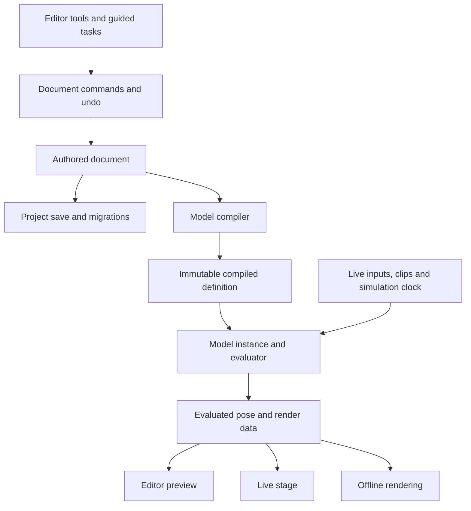

# Twber rework plan

Status: proposed implementation plan, 2026-10-11. Product direction confirmed by the user; technical choices below are recommendations unless explicitly marked as open. This document plans the work; it does not claim the features are implemented.

Implementation started, 2026-10-11. The first increment fixes inactive Animate
preview restoration and sparse timeline channel ownership, and adds a tested
document/command foundation. See [the implementation notes](rework-progress.md)
for its current scope and remaining integration work. P0 and P1 are still in progress.

## 1. Product direction

Build a desktop 2D character authoring application in which the same character can be rigged, performed live, animated on a timeline, and exported as finished media or a Twber runtime asset.

Confirmed decisions:

- Live avatars and animation production have equal priority in the first major release. Neither is a placeholder workflow.
- Twber owns its model format and runtime. The target is comparable creative usefulness to Cubism; Cubism project import and Live2D runtime export are outside the agreed scope.
- A substantially easier learning curve is a primary product requirement.

Planning assumptions:

- Retain Godot and initially deliver Linux and Windows, matching the current release pipeline. Validate both throughout development.
- Keep layered PNG, animated sprites, and pixel-art workflows as first-class options alongside mesh-deformed characters.
- Preserve existing user documents through an importer. Save upgraded documents separately; retain the original.
- Reuse proven algorithms and platform integrations after testing them behind the new interfaces.
- Deliver the replacement incrementally, with complete workflows at each integration milestone. The final architecture replaces the current ownership model.

The first major release should support an expressive illustrated bust: head turn and tilt, gaze, independent blinking, mouth opening and shape, expressions, hair/accessory motion, masking, and animated draw order. It should also support a simpler PNG puppet without requiring mesh or deformer setup.

## 2. What “as useful as Cubism” means here

Use concrete production tasks as the benchmark. A broad feature checklist alone does not establish usability or parity. Cubism's documented authoring foundation includes [warp and rotation deformers](https://docs.live2d.com/en/cubism-editor-manual/deformer/), [automatic](https://docs.live2d.com/en/cubism-editor-manual/mesh-edit/) and [manual mesh editing](https://docs.live2d.com/en/cubism-editor-manual/mesh-edit-manual/), and [additive blend shapes](https://docs.live2d.com/en/cubism-editor-manual/blend-shape/). Twber needs equivalent creative building blocks with its own implementation and terminology.

| Capability | Current basis | First major release outcome |
| --- | --- | --- |
| Artwork | Individual images, trimming, sprite frames | Layered PNG import, PSD layer import, hierarchy preservation, explicit artwork replacement/relinking, source images retained |
| Editing reliability | Dirty tracking, autosave, scene snapshots | Transactional edits, undo/redo, recovery, reliable save, document-independent preview |
| Meshes | Grid/manual vertices and topology | Alpha-aware automatic mesh, manual topology, soft-selection/brush deformation, mirror editing, safe topology-change policy |
| Deformation | Layer transforms and direct mesh poses | Nested rotation and warp deformers, editable control cages, local mesh corrections, deformer-aware picking |
| Rigging | Scalar/vector parameters and sparse states | One-axis keys, paired-axis rigs, combination corrections, additive expressions, channel ownership, parameter organization |
| Rendering | Atlases, indexed triangles, batching, clipping | Mesh masks, nested/inverted masks, opacity, animated order, required blend modes, consistent live and export output |
| Secondary motion | No dedicated physics system | Fixed-step spring/pendulum chains, presets, parameter routing, simulation preview and baking |
| Animation | Layer snapshots on a basic timeline | Parameter/property tracks, dope sheet, curve editor, clips, transitions, audio, recording, deterministic seeking, media export |
| Live performance | Mouse/microphone packages and stage | Input mapping/calibration, blink/breath behaviors, expressions/hotkeys, face-tracking integration, saved multi-model stage, capture output |
| Reuse | Duplication/mirroring and PCK extensions | Editable rig templates, parts/presets, versioned runtime API, packages whose behavior is independent of settings controls |

Artwork updates matter as much as initial import: Cubism documents [PSD import and replacement](https://docs.live2d.com/en/cubism-editor-manual/psd-import/). Twber must preserve layer identity and rigging when artwork changes, and show ambiguous matches before applying them.

Animation production requires both timing tools and deliverables. The reference includes a [graph editor](https://docs.live2d.com/en/cubism-editor-manual/grapheditor/) and [image/video export](https://docs.live2d.com/en/cubism-editor-manual/exporting-images/). Twber's release gate therefore includes curves, audio synchronization, transparent image sequences, and an ordinary video export workflow.

Later expansion: path/curve deformers, sophisticated skinning and mesh stitching, advanced procedural controllers, extended compositing, larger production scenes, macOS/web/mobile runtimes, and an external integration ecosystem. These remain visible capability gaps; the first release should not be advertised as exhaustive Cubism feature parity.

## 3. Make learning easier through the workflow

### A shared, progressive workspace

Use task-oriented workspaces: **Artwork → Rig → Animate → Perform**. These are views over one document and one evaluated model. Switching workspace never restores or writes authored geometry.

Keep selection, pan/zoom, transform handles, snapping, undo, and terminology consistent. Advanced controls appear when needed, with search and direct access for experienced users. Guided and advanced tools create the same underlying data.

The user should always be able to tell whether they are editing artwork/rest geometry, a rig sample, an expression, or a timeline key. Previewing a control does not implicitly enter an editing mode. A rig edit session isolates the selected contribution while showing other contributions as context; commit and cancel are explicit.

### Guided tasks that produce editable rigs

| Task | User supplies | Twber creates | Advanced access |
| --- | --- | --- | --- |
| Blink | Eye parts and an open/closed example | Eye-open parameter, samples, optional automatic blink behavior | Sample geometry, easing, independent eyes |
| Mouth | Mouth parts and closed/open examples | Mouth controls, samples, microphone mapping preset | Shape controls, phoneme poses, curves |
| Look around | Eye parts and gaze limits | Paired gaze controls and keys | Corner corrections and asymmetry |
| Head turn | Head group and artist-shaped directions | Deformer structure and a paired rig | Additional samples and combinations |
| Hair motion | Hair group, attachment point, desired stiffness | Rotation/warp rig and physics preset | Chain, damping, routing, limits |
| Expression | User-adjusted controls | Named parameter preset with fade behavior | Blend mode, masks, conflict priority |

These helpers set up a rig and reduce repeated work. They do not promise to infer convincing unseen anatomy or a finished head turn from arbitrary artwork. Preview suggested setup before committing; one Undo reverses it.

Teach with a bundled simple puppet and a fully rigged illustrated character. Provide short contextual instructions, visible before/after comparisons, and an inspector answering “what is moving this part?” with the contributing parameter, clip, expression, or physics group.

### Usability acceptance targets

Provisional targets to validate with at least five people unfamiliar with Twber:

- At least four can import prepared artwork, create a blink and talking mouth, and run a live preview in 30 minutes using in-app guidance.
- At least four can animate a provided rig into a 10-second clip with audio and export it in 30 minutes.
- At least four can distinguish rest editing, rig-sample editing, and playback without intervention after onboarding.
- Every tester can recover a mistaken edit with Undo and locate the source of a deliberately conflicting motion.
- An experienced rigger can bypass helpers, create asymmetric poses and paired-axis corrections, and reuse parts without rebuilding the rig.

Measure completion, errors, assistance, and abandoned steps. Use the same prepared assets and tasks when comparing with Cubism; do not claim a learning-curve improvement without that evidence.

## 4. Ownership and module boundaries

Each viewer has its own instance; the diagram means shared implementation, not a shared mutable playhead. Compiled definitions and asset content may be shared.

| Object/module | Owns | Must not own |
| --- | --- | --- |
| ModelDocument | Stable identities, rest geometry, assets, rig definitions, expressions, model clips, physics definitions | Nodes, selection, live input values, evaluated vertices, atlas page assignments |
| EditorSession | Selection, active editing target, tools, camera, temporary edit transaction | A competing saved model or long-lived neutral-pose copy |
| AnimationScene | Model references, instance placement, clip arrangement, scene tracks, audio, export settings | Copies of model rest geometry |
| ModelCompiler | Validation, dependency indices, sampled-rig structures, sorted tracks, deformer bindings | UI controls or modifications to authored data |
| CompiledModel | Immutable indexed definitions and asset references | Per-instance animation or physics state |
| ModelInstance | Parameter values, playheads, fades, input history, simulation state, pose buffers | Authored-data edits |
| Renderer | GPU resources, mask passes, batches, picking maps, viewport state | Document truth, migration, keyframe changes |
| InputBinding | Mapping, calibration, smoothing, dead zones, routing configuration | Widgets or settings scenes |
| Persistence | Versioned data encoding, asset storage, migrations, diagnostics, atomic writes | Preview manipulation or runtime simulation |

Godot Resources, RefCounted objects, vectors, and packed arrays remain appropriate. Model evaluation must work without a SceneTree or CanvasItem. Treat compiled resources as immutable by API contract; exported Resource properties alone do not enforce immutability.

Suggested directories: `core/document`, `core/commands`, `core/rig`, `core/animation`, `core/physics`, `core/compile`, `core/io`, `runtime`, `rendering`, `editor`, `environment`, and `testing`. Move code as responsibilities are extracted, rather than doing a directory-only rewrite.

## 5. Authored model and editing contract

### Identities and relationships

- Assign persistent IDs to documents, assets, parts, meshes, deformers, parameters, samples, expressions, clips, and physics groups. Names and display order can change independently.
- Give mesh topology a revision and vertices stable identities. Vertex count alone cannot establish that two shapes use compatible topology.
- Keep organizational grouping, transform/deformer parenting, render order, and mask relationships distinct. Present a convenient combined hierarchy by default, but do not encode every relationship as scene-node parenting.
- Initially give a drawable one ordered deformer chain. Additional multi-influence skinning requires a later explicit design; do not start with an unrestricted graph editor.
- Store source-canvas coordinates and rest geometry independently from texture trimming and atlas UVs. Viewport pan/zoom and live-stage placement are never model geometry.
- Use semantic control tags such as eye-open or mouth-open for templates and inputs; human-readable names remain freely editable. Define units and coordinate conventions at module boundaries.

### One route for authored changes

Commands include `AddPart`, `DeletePart`, `Reparent`, `MovePivot`, `EditRestTransform`, `EditTopology`, `ReplaceArtwork`, `SetRigSample`, and `EditAnimationTrack`.

Each command validates its intent, commits one atomic document transaction, records sufficient inverse data for Undo, and emits a typed change set. Changes identify structure, topology, geometry, rig samples, assets, tracks, and render properties separately so consumers invalidate only necessary caches.

Drags use a temporary edit transaction and become one undo step. Cancel restores the transaction's starting state. Compound helpers, duplication, mirroring, and reparenting are also single undoable actions. Dirty tracking uses the undo history/save checkpoint, including undoing back to a saved state and branching after Undo.

Pivot changes must preserve evaluated appearance throughout affected poses. Reparenting across animated deformers cannot always be represented by a single static transform: provide an evaluated transfer/bake path or an explicit diagnostic. Never claim preservation if the representation cannot express it.

Topology changes have three outcomes: exact correspondence for supported edits, a previewed deformation-transfer operation with measured error, or an explicit reset of selected dependent shapes. Never silently replace incompatible animation geometry with neutral geometry. Store the transfer map and previous data so Undo is exact.

### Renderer isolation

The first adapter can update existing Sprite2D/mesh nodes from document and pose data. Those nodes are disposable projections. Tools resolve a picked primitive to a document ID and submit a command; they never author by changing the render node.

This allows existing direct-triangle rendering and atlas logic to survive while removing node metadata as the document database.

## 6. Rig evaluation and animation semantics

Specify and test this contract before moving existing evaluation code.

### Frame pipeline

1. Read timestamped live input or recorded input; apply calibration and mapping.
2. Sample clips, automatic behaviors, and expression weights into parameter contributions.
3. Resolve parameter contributions using explicit priority, blend mode, and channel masks.
4. Step physics on its fixed clock using resolved driver parameters; apply physics outputs to designated channels.
5. Evaluate rig samples and corrective combinations into local transforms, deformer controls, and mesh deltas.
6. Apply explicit property/geometry animation tracks at their declared stage and priority.
7. Evaluate the deformer hierarchy and resolve visibility, color, masks, draw order, and render packets.

Reject same-frame feedback cycles. A delayed feedback connection, if supported later, must be explicit. Evaluation order comes from dependencies and documented priorities, never dictionary insertion order.

### Composition rules

| Contribution | Default behavior |
| --- | --- |
| Missing channel | No contribution; preserves the result from earlier stages |
| Ordinary rig sample | Interpolated authored shape relative to that rig binding's rest/reference shape |
| Additive expression/correction | Weighted delta in a declared local space; does not carry unrelated channels |
| Override clip/track | Blends only its channel mask against the lower-priority result |
| Rotation | Unwrapped angles for authored multi-turn animation; shortest-path interpolation only when selected |
| Scale | Linear interpolation between positive keyed scales; additive layers compose weighted ratios relative to their reference scale. Mirror/flip is discrete; preserve legacy additive or zero/negative-scale behavior through an explicit compatibility path |
| Visibility, sprite selection, discrete order | Stepped values with deterministic priority and tie-breaking |
| Parameter and opacity limits | Applied at documented stages; inspector can show the unclamped contribution |

New timelines primarily animate rig parameters, which makes clips reusable. Explicit property and mesh/deformer tracks remain available for effects and imported legacy animations. Track targets include stable object ID, property/channel, and applicable topology revision.

Support scalar sample curves, paired scalar controls displayed on a 2D plane, and the current Vector2 controls. Paired rigs must represent corner corrections; two independent additive one-axis rigs alone are insufficient for expressive head turns. Start with documented 1D interpolation and a compiled 2D triangulated sample domain, including explicit boundary behavior and editable extra samples. Add sparse corrections for named parameter combinations without forcing a full combinatorial grid.

Rotation and warp deformers are model entities. Prototype a smooth lattice evaluator and its rest-space bindings before freezing the schema. Validate nested rotation/warp order, off-cage behavior, mesh selection under deformation, and deformation inversion during editing. Store evaluated vertices separately from source vertices. A guided edit should modify the selected contribution, not infer it by subtracting arbitrary final scene-node states.

Compile tracks by target and sort once. Build parameter-to-binding and deformer-to-descendant indices once per relevant document revision. Reuse pose buffers and update affected regions. Use a straightforward reference evaluator to check the optimized evaluator within numerical tolerances.

Trigger semantics are explicit: rising-edge one-shot, hold/loop, toggle, restart policy, fade-in/out, and release behavior. Non-looping clips stop advancing at completion. Parameter thresholds use hysteresis where appropriate. The diagnostics view explains conflicting owners of the same channel.

## 7. Physics, live performance, and animation production

### Shared simulation

Provide spring/pendulum presets for hair, accessories, breathing, and body follow-through, with editable inputs, outputs, damping, stiffness, and limits. Cubism's [physics workflow](https://docs.live2d.com/en/cubism-editor-manual/physics-operation/) provides a useful reference for parameter-driven secondary motion.

Use a fixed simulation step independent of UI/render frequency. Offline export advances exactly to requested sample times; timeline seeking restores a checkpoint and resimulates, with an explicit preroll policy. Seed procedural noise/blink behavior for reproducibility. Promise deterministic behavior for the same build and input trace within defined tolerances, not cross-platform floating-point bit identity.

Physics baking writes ordinary parameter tracks and can be undone. Scrubbing, live recording, and export must use the same simulator. Include dropout/reacquisition behavior for live trackers so reconnecting does not create explosive motion.

### Complete live workflow

- Keep mouse and microphone sources; move their mappings into non-UI binding objects.
- Add keyboard/expression triggers, calibration, smoothing, inversion, ranges, and per-model binding presets.
- Include a documented end-to-end face-tracking path in the first major release. Select either an integrated tracker or a supported external protocol adapter after a feasibility spike; an empty plugin interface is insufficient.
- Show unsupported/missing tracking inputs and support a camera-free mouse/microphone workflow.
- Preserve independent state across multiple instances of the same compiled model; share immutable assets only.
- Keep stage placement, backgrounds, attachments, and capture configuration in workspace data rather than model rest transforms.
- Provide a clean capture window, explicit background/alpha options, and a tested OBS capture recipe on each supported platform. Native virtual-camera output is a later capability unless the platform spike establishes a small, reliable implementation.
- Record normalized input/parameter traces with timestamps into animation takes; retain raw traces optionally for recalibration.

### Complete animation workflow

- Model clips plus scene-level tracks for multiple character instances, background, placement, and camera framing.
- Dope sheet and curve editor, stepped/linear/Bezier interpolation, copy/paste, retiming, loop ranges, track muting/soloing, explicit auto-key, and clip fades.
- Audio import, waveform, scrubbing/playback synchronization, and live-performance recording into editable takes.
- Bake physics; scrub accurately before and after baking. Export uses a fixed sample clock rather than display-frame timing.
- Export still PNG and alpha PNG sequences, plus a supported video encoder workflow with audio and actionable errors. Choose the encoder/distribution approach during the platform spike and document available codecs; do not assume every codec supports alpha.
- Include a queue with cancellation and progress. A failed export must not change the authored project or leave a file presented as complete.

## 8. Assets, rendering, persistence, and extensions

### Artwork and rendering

Import jobs produce stable source asset records, lossless pixel content, original canvas placement, and layer mappings. PSD support needs a tested feature envelope for groups, visibility, offsets, color handling, and blend modes; unsupported features receive an import report. Start with correctness fixtures from multiple authoring tools before choosing the decoder implementation.

Reimport matches persistent source identities where available, then offers a preview for ambiguous name/hierarchy matches. Preserve mesh and rig references for unchanged artwork. Size/canvas changes invoke an explicit remapping operation. Source-file edits do not silently alter the content saved in an open project.

Use one atlas packing/compression service for previews and exports. Atlases and GPU variants are rebuildable derived data keyed by source content and build settings. GPU format selection is capability-based. Keep pixel-art sampling and trim metadata behavior.

Define masks as render relationships supporting animated mesh masks, nested masks, inversion, and opacity. Target normal, additive, multiply, and screen blending for the first release. Establish premultiplied/straight-alpha conventions and blend-mode semantics with pixel fixtures. Preserve draw order while batching compatible contiguous geometry; correctness takes precedence when masks or materials require separate passes. Report the actual cost of those boundaries.

### Project files and runtime assets

Keep `.twber` as a portable authoring project, with a newly versioned schema. Proposed contents: manifest, authored model/scene data, checksummed lossless source blobs, and optional rebuildable preview caches. Runtime export is a distinct artifact with compiled data and GPU-ready assets; its filename/extension is an open format decision.

Saving reads a document snapshot and never evaluates or changes a preview. Loading parses and migrates data, validates it, and returns structured diagnostics before constructing render resources. Migrations are explicit version-to-version functions; ordinary saves do not run a generic repair pass that changes valid authoring settings.

Give every background job a document ID, revision, cancellation state, and immutable snapshot. A completion for an old document cannot update the new document's status, recovery path, dirty flag, or compiled cache. Serialize writes to the same destination. Mark only the captured revision as saved; edits made while saving remain dirty.

Do file I/O, decoding, compression, and pure-data compilation on isolated worker inputs. Create GPU/scene objects through an explicit owning-thread handoff. Shared asset caches require synchronization or a single owner; worker jobs must not mutate live Resources.

Retain atomic replacement and checksums. Add bounded archive parsing, missing-asset diagnostics, per-document recovery, restart recovery of interrupted writes, and predictable unknown-version rejection. Recovery captures authored state even while an animation is playing.

### Existing documents and packages

Import current archives, legacy JSON/base64 packages, and existing trusted `.tres`/`.res` documents into the new schema through adapters. Preserve historical interpolation/composition semantics with a versioned compatibility mode where conversion is not equivalent. Document corrections to known bugs; do not enshrine edit-loss or channel-overwrite bugs as compatibility requirements.

Version the package contract. Separate input providers, pure input mapping, stage extensions, and optional settings UIs. Port the four bundled packages and test them in exported builds. Report incompatible third-party packages clearly; provide an adapter only where behavior can be preserved. Existing PCKs execute code, so ordinary model documents must not gain that capability as part of the new format.

## 9. Implementation sequence and release gates

Effort labels describe relative scope, not calendar promises. Estimate staffing and dates after the P0/P1 spikes; the renderer, PSD importer, tracking integration, and deformation transfer have material uncertainty.

| Phase | Deliverable | Dependencies | Exit gate | Scope |
| --- | --- | --- | --- | --- |
| P0 — Contracts and characterization | Regression fixtures, reviewed data/evaluation contracts, feasibility spikes | None | Reproductions captured; expected semantics and prototype results recorded | Medium |
| P1 — Document foundation | New document, commands/undo, snapshots, save/load, legacy adapter, minimal render projection | P0 | Import → edit → undo → save → reopen works without scene capture | Large |
| P2 — Shared execution slice | Compiled rig, instance evaluator, parameter/property tracks, input bindings | P1 | Same simple rig performs live, records a take, plays it, and exports PNG frames identically | Large |
| P3 — Artwork and deformation | PSD/reimport, automatic/manual mesh, nested deformers, mask/order renderer, edit transfer policy | P2; P0 spikes | Illustrated character survives artwork replacement, pivot edits, deformation and save/reload | Very large |
| P4 — Expressive rigging and motion | Paired rigs, corrective samples, expressions, guided tasks, physics and baking | P3 | Reference bust supports combined head/eye/mouth/expression motion with stable secondary motion | Very large |
| P5 — Production and performance workspaces | Full timeline/curves/audio/video export and full live tracking/calibration/capture workflow | P4; preliminary interfaces in P2 | Both complete user journeys pass on Linux and Windows | Very large |
| P6 — Migration, learning, and release | Sample projects, tutorials, usability rounds, profiling, packages, recovery and release validation | P5 | First-major-release checklist passes; old authoring path can be removed | Large |

Prototype dependent features early: PSD, nested masks, warp evaluation, face tracking, video encoding, and topology transfer belong in P0 investigations. P3–P5 integrate proven approaches rather than discovering those constraints after the document format has been finalized.

P2 is an architectural acceptance slice, not the first major release. P5 gives animation and live performance separate acceptance owners/checklists even if one developer performs both roles. Neither workflow can be dropped to meet a date while retaining the agreed release scope.

### P0 investigations and decisions

| Decision | Investigation | Required result |
| --- | --- | --- |
| D1: Deformer math | Nested rotation/warp prototype, inverse editing, out-of-bounds points | Chosen interpolation, binding representation, limitations, numeric fixtures |
| D2: Masks and blending | Animated mesh masks, nesting/inversion, draw-order animation in Godot | Correct pixel output and viable rendering passes on both target platforms |
| D3: PSD decoding | Representative PSD corpus and available decoder feasibility | Supported feature set, dependency choice, cancellation/memory behavior |
| D4: Face tracking | Integrated tracker versus concrete external protocol | Working capture-to-parameter demonstration and supported setup path |
| D5: Video/capture delivery | Audio/video encoder, alpha sequence, Windows/Linux capture | Packaging approach and reproducible end-to-end export/capture tests |
| D6: Geometry transfer | Vertex insertion/removal and rest changes across rig samples | Exact supported cases, transfer errors, and explicit unsupported cases |
| D7: File schema | Authoring/runtime separation and legacy sample corpus | Schema draft, migration fixtures, artifact naming and cache rules |

### First implementation backlog

1. Add isolated regressions for Place edits surviving save capture and tab switches, and for color-only timelines preserving parameter-driven position. Fix these data-loss/composition defects in the current path while replacement work proceeds.
2. Build a small fixture corpus: PNG puppet, trimmed/animated sprites, parameter-driven mesh, nested groups/masks, overlapping parameters/timelines, and a larger stress model. Record intended behavior and known exceptions.
3. Write the document schema and evaluation contracts with examples for neutral pose, sparse channels, paired controls, property tracks, and legacy imports.
4. Prototype D1–D7; record each result before freezing the affected interface.
5. Implement a minimal document and validator with IDs, hierarchy, assets, one mesh, one parameter, and one clip.
6. Implement atomic commands, compound transactions, Undo/Redo, revision/change sets, and saved-state checkpoints.
7. Implement pure snapshot persistence and the current `.twber` importer; test interrupted saves and migration diagnostics.
8. Implement a disposable render projection and ID-based picking. Route one Place transform through document commands.
9. Extract pure rig sampling/composition and compile it into an instance evaluator; compare reference and optimized output.
10. Move clip playback into that evaluator and extract input mapping from controls. Prove a scene-free instance can evaluate both.
11. Complete the P2 flow: live parameter input → recorded take → timeline playback → fixed-time PNG sequence, with equal pose output.
12. Migrate remaining tools operation by operation; remove each former write path and private base-state cache as its command replacement lands.

No command should leave a tab as a second authoritative owner. Temporary adapters may read legacy data or project new data into nodes; avoid bidirectional synchronization between two editable model stores.

## 10. Verification and measurable acceptance

### Correctness gates

- Saving, autosaving, reporting performance, tab switching, and scrubbing never change authored content or discard a committed edit.
- Undo/Redo round-trips compound operations, dependent bindings, topology, and asset replacements; canceling a drag is exact.
- A color-only track cannot move a part; two disjoint channel contributions coexist; conflicts have reproducible explicit priority.
- Pivots, hierarchy changes, and topology transfers update all dependent samples/tracks or report an unsupported operation before commit.
- Editor preview, live runtime, and offline export produce equivalent poses for the same time/input trace; pixel output agrees within defined renderer tolerances.
- Multiple instances of one model have independent parameters, playheads, physics, and input bindings.
- Rest vertices and authoring assets remain unchanged after long playback and runtime atlas rebuilds.
- Seeking and export reproduce physics with the documented seed, fixed step, checkpoints, and preroll.
- Reimported art preserves identity and untouched rigging; missing assets and ambiguous replacements are recoverable.
- Worker completion cannot mark a newer revision saved or attach results to another document.

Use pure-data unit/property tests for math and invariants, scene integration tests for commands and adapters, image comparisons for masks/deformation/blending, migration fixtures for formats, and full workflow tests for the two release journeys. Keep a documented reference evaluator and golden assets; avoid tests that merely repeat implementation details.

### Performance gates

Provisional workload: one 200-drawable character, roughly 20,000 mesh vertices, 60 controls, 30 deformers, eight physics chains, and four simultaneous clips/expressions; include masks and animated order. Also test four smaller simultaneous instances. Record atlas size, visible area, render backend, display resolution, CPU, GPU, and build configuration.

Select representative minimum/reference Linux and Windows machines in P0. Initial targets are 60 fps during ordinary playback, p95 evaluation plus CPU render preparation under 8 ms for the reference character, and p95 total frame time under 16.7 ms. Treat these as budgets to validate, not existing measurements or promises for every model. Report CPU and GPU separately and exclude asset loading from steady-state timing while measuring it separately.

Drag and parameter feedback should appear within one displayed frame under that workload. Idle instances should not continuously reevaluate unchanged data. Save/import/compile/export tasks remain cancelable where meaningful and do not block interaction for sustained periods. Establish memory limits and loading targets from the fixture corpus before P3; test that opening/closing and replacing models repeatedly releases instance and GPU resources.

### First-major-release demonstrations

1. Start with layered artwork; create an expressive rig using guided and advanced tools; save, close, and reopen without visual or semantic changes.
2. Perform it with tracking, expressions, and physics; capture clean output; disconnect/reconnect inputs; reload a saved multi-model stage.
3. Record a take, edit curves against audio, combine it with another clip, bake physics, and export a short scene as video and transparent image sequence.
4. Replace part of the artwork, adjust a pivot, undo/redo, and verify both live and animation workflows remain correct.
5. Open representative older projects and inspect migration reports; original files remain intact.
6. Complete the novice usability tasks and the documented Windows/Linux release pipeline from packaged builds.

## 11. Reuse and replacement map

| Existing code | Treatment |
| --- | --- |
| `shared/model/twber_model_resource.gd` and related resources | Use as import DTOs; evolve toward the explicit authored schema, with topology/version metadata |
| `shared/model/twber_model_codec.gd` | Extract archive storage, migrations, texture compilation, diagnostics, and legacy scene adapter into separate modules |
| `shared/model/twber_parameter_mapper.gd` | Preserve verified interpolation math; move composition to the pure evaluator and remove live-node capture/application |
| `shared/model/twber_runtime_model.gd` | Become a Godot-facing host for an independent ModelInstance and renderer |
| `shared/model/twber_mesh_resource.gd` | Separate rest topology from evaluated vertices; centralize mutation and transfer rules |
| `shared/model/twber_model_batch_renderer_2d.gd` and mesh renderer | Reuse indexing/buffer techniques behind the projection/render-packet interface; extend for deformers and masks |
| Texture trimming/cache/atlas utilities | Retain tested pixel behavior; centralize asset ownership, packing, capability selection, and worker safety |
| Place/Mesh/Rig/Animate scripts | Retain useful interaction code; replace direct model mutations and per-tab neutral caches with shared operations and edit sessions |
| Environment input controls and packages | Split runtime mapping from UI, version the package API, and preserve tested stage functionality |
| Settings, launcher, release tools | Keep and adapt document/workspace paths as needed; continue packaged-build smoke tests |

The change is complete when adding a new model property has a clear path through its schema, evaluator/render support, and shared editing command, with persistence and preview behavior governed by those common contracts.
